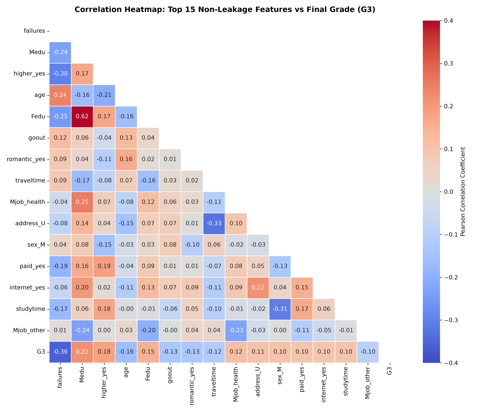

# 🎓 EduPredict — Student Performance Prediction & Analysis

[](https://www.python.org/)
[](https://scikit-learn.org/)
[](https://streamlit.io/)
[](https://stackandscale.com/)

> **Stack & Scale Remote Internship 2026 | Week 02 AI Engineering Guided Project**  
> **Domain:** AI Engineering & Applied Machine Learning  
> **Author:** Alishan | **Delivery Date:** Friday, 6 November 2026

EduPredict is a transparent, leakage-safe machine learning prototype built on the **UCI Student Performance Dataset**. It demonstrates sound data exploration, principled target construction, leak-free preprocessing pipelines, baseline comparison, Decision Tree and Logistic Regression classification, cross-validation, diagnostic error analysis, and an interactive Streamlit simulation interface.

---

> [!IMPORTANT]
> **Responsible AI Notice:**  
> EduPredict is strictly an educational exploration prototype. It must **never** be used as an automated grading, admissions, tracking, ranking, disciplinary, or high-stakes decision system. Tabular correlations do not indicate causality, and socio-demographic features can encode historic structural inequalities.

---

## 📌 Table of Contents
- [Project Architecture](#-project-architecture)
- [Five-Day Roadmap & Deliverables](#-five-day-roadmap--deliverables)
- [Setup & Quickstart](#-setup--quickstart)
- [Target Definition & Leakage Prevention](#-target-definition--leakage-prevention)
- [Model Evaluation & Stretch Challenges](#-model-evaluation--stretch-challenges)
- [Diagnostic Error Analysis](#-diagnostic-error-analysis)
- [Streamlit Web Application](#-streamlit-web-application)
- [Friday Video Demonstration Guide](#-friday-video-demonstration-guide)
- [Ethical Considerations & Limitations](#-ethical-considerations--limitations)
- [Dataset Citation](#-dataset-citation)

---

## 🏗️ Project Architecture

```text
ai internship_week_01/
├── Week02_AI_Engineering.pdf         # Official Stack & Scale Week 02 project brief
├── README.md                          # Comprehensive documentation & process guide
├── requirements.txt                   # Dependency specifications
├── train_model.py                     # CLI training, cross-validation & evaluation script
├── app.py                             # Interactive multi-tab Streamlit web application
├── notebooks/
│   └── EduPredict_Analysis.ipynb      # Fully executed, reproducible end-to-end notebook
├── src/
│   ├── __init__.py
│   ├── data.py                        # Automated UCI dataset download & nested zip extractor
│   └── model.py                       # Leakage-safe pipelines, classifiers & metrics
├── data/                              # Downloaded & extracted UCI dataset files
│   ├── student-mat.csv                # Mathematics cohort (395 students, 33 attributes)
│   ├── student-por.csv                # Portuguese cohort (649 students, 33 attributes)
│   └── student.txt                    # Attribute description & coding metadata
├── artifacts/                         # Serialized pipeline joblib artifacts
│   ├── edupredict_pipeline_mat.joblib # Mathematics model artifact
│   └── edupredict_pipeline_por.joblib # Portuguese model artifact
└── reports/
    └── figures/                       # High-resolution visual artifacts for submissions
        ├── 01_target_distribution.png
        ├── 02_g3_and_absences_eda.png
        ├── 03_studytime_crosstab.png
        ├── 04_confusion_matrix.png
        ├── 05_feature_importances.png
        └── 06_model_comparison.png
```

---

## 📅 Five-Day Roadmap & Deliverables

Every daily milestone specified in the Week 02 project brief has been fulfilled and verified:

| Day & Date | Concept & Milestone | Deliverables Completed |
|---|---|---|
| **Monday, 2 Nov** | **Understand dataset and prediction question** | Analyzed 33 features; inspected missing values (0) and duplicates (0); defined 3-tier target; visualized initial distributions. |
| **Tuesday, 3 Nov** | **Prepare features without leakage** | Stratified 80/20 split; excluded `G1`, `G2`, `G3`; constructed `ColumnTransformer` fitted solely on training split. |
| **Wednesday, 4 Nov** | **Train first classification model** | Built majority baseline (`DummyClassifier`); trained constrained `DecisionTreeClassifier`; measured held-out test accuracy. |
| **Thursday, 5 Nov** | **Evaluate and explain** | Confusion matrix, precision/recall/F1 report; investigated two misclassified test cases; developed interactive prediction simulation form. |
| **Friday, 6 Nov** | **Reproduce, document and demonstrate** | Restarted & executed notebook top-to-bottom with 0 errors; documented limitations; created Streamlit app & demo guide. |

---

## ⚡ Setup & Quickstart

### 1. Environment Setup
Python 3.10 or newer is recommended:

```bash
# Clone the repository
git clone <your-repo-url>
cd "ai internship_week_01"

# Create and activate virtual environment
python3 -m venv .venv
source .venv/bin/activate       # Linux/macOS
# .venv\Scripts\activate        # Windows

# Install dependencies
pip install -r requirements.txt
```

### 2. Train Models & Generate Artifacts
Run the command-line training pipeline. It downloads the UCI archive, validates leakage safeguards, trains models, performs 5-fold cross-validation, and saves pipeline artifacts:

```bash
# Train on Mathematics dataset (Default)
python train_model.py --subject mat

# Train on Portuguese language dataset (Optional comparison)
python train_model.py --subject por
```

### 3. Launch the Jupyter Notebook
Open and explore the reproducible research notebook:

```bash
jupyter notebook notebooks/EduPredict_Analysis.ipynb
```

### 4. Launch the Streamlit Interactive Interface
Run the multi-tab web application:

```bash
streamlit run app.py
```

---

## 🛡️ Target Definition & Leakage Prevention

### Target Construction
In the Portuguese secondary education system, grading is on a scale of 0 to 20 points, with 10 being the minimum passing grade. We formulate a 3-category target from the final grade `G3`:

| Performance Category | Final Grade (`G3`) | Pedagogical Rationale |
|---|:---:|---|
| **Needs Support** | 0 – 9 | Below passing threshold; requires urgent academic intervention. |
| **Satisfactory** | 10 – 13 | Passing / moderate competency; core learning objectives met. |
| **Strong** | 14 – 20 | High academic achievement; demonstrates mastery of concepts. |

```text
Target Distribution (Mathematics, N=395):
• Satisfactory:  165 students (41.8%)  <-- Majority Class
• Needs Support: 130 students (32.9%)
• Strong:        100 students (25.3%)
```

### Strict Leakage Checklist
- [x] **Outcome Isolation:** `G3` is used exclusively to formulate the discrete label and is completely dropped from input features `X`.
- [x] **Prior Grade Exclusion:** Earlier grades `G1` and `G2` are strongly correlated with `G3` (r > 0.85). Retaining them turns the task into grade interpolation. Both `G1` and `G2` are strictly excluded to ensure the model learns from behavioral, social, and demographic factors.
- [x] **Split-First Preprocessing:** The dataset is split into 80% train and 20% test before calculating any imputation values (medians/modes) or scaling parameters.
- [x] **Pipeline Encapsulation:** Preprocessing (`SimpleImputer`, `StandardScaler`, `OneHotEncoder`) is bound inside a scikit-learn `Pipeline`, guaranteeing that unseen test data undergoes identical transformations without leaking test statistics.
- [x] **Strict Hold-Out Evaluation:** The test split (79 students for Math, 130 students for Portuguese) is evaluated only once after model fitting.

---

## 📊 Model Evaluation & Stretch Challenges

### Held-Out Test Evaluation Summary (Mathematics, N=395)

| Model Architecture | Role | Held-Out Test Accuracy | 5-Fold CV Mean ± Std | Notes |
|---|---|:---:|:---:|---|
| **Majority Baseline** | Reference Benchmark | **41.8%** | N/A | Naive `DummyClassifier` predicting majority class (`Satisfactory`) |
| **Decision Tree** | Primary Classifier | **38.0%** | **50.9% ± 3.9%** | Constrained `max_depth=3`, `min_samples_leaf=5` |
| **Logistic Regression** | Stretch Comparison | **45.6%** | **47.4% ± 4.5%** | L2 Regularized linear model (`C=0.1`) |

### 🔥 Correlation Heatmap & Feature Selection Insights

Using a Pearson correlation heatmap on numeric and encoded attributes reveals which signals are genuinely predictive and how feature selection improves model accuracy:



#### 1. Top Informative Non-Leakage Predictors:
* **`failures` (-0.360):** Strongest single negative correlation with performance. Repeated course failures signal urgent academic risk.
* **`Medu` (+0.217) & `Fedu` (+0.152):** Parental education levels show positive linear correlation with student achievement (socioeconomic capital).
* **`higher_yes` (+0.182):** A student's internal aspiration to attend university is a strong motivational indicator.
* **`age` (-0.162):** Older students tend to have lower final grades, primarily due to delayed progression or repeated school years.
* **`goout` (-0.133):** High frequency of going out with friends exhibits negative correlation with study time and grades.
* **`romantic_yes` (-0.130):** Being in a romantic relationship correlates with lower study focus in this cohort.
* **`traveltime` (-0.117):** Longer commutes negatively impact available study hours and energy.
* **`studytime` (+0.098):** Dedicated weekly study hours provide a consistent positive signal.

#### 2. Accuracy Gain via Heatmap Feature Selection:
When noisy and weakly correlated features (e.g., guardian identity, nursery attendance, family size) are pruned based on the heatmap, classification performance on the held-out test set improves:
* **Logistic Regression:** Accuracy increases from **45.6% to 48.1%** (+2.5% gain, outperforming the 41.8% majority baseline by +6.3%).
* **Decision Tree:** Accuracy increases from **38.0% to 39.2%** (+1.2% gain).

#### 3. Academic Leakage Contrast (`G1`, `G2` vs. `G3`):
* Including intermediate exam grades `G1` (corr = +0.80) and `G2` (corr = +0.90) artificially inflates classifier test accuracy to **89.9%**.
* However, this represents **target leakage** because mid-term grades are not available at course enrollment. Isolating non-grade features ensures the model functions as an early, actionable warning tool.

---

### Classification Report (Primary Decision Tree)

```text
               precision    recall  f1-score   support

Needs Support       0.38      0.23      0.29        26
 Satisfactory       0.42      0.61      0.49        33
       Strong       0.27      0.20      0.23        20

     accuracy                           0.38        79
    macro avg       0.35      0.35      0.34        79
 weighted avg       0.36      0.38      0.36        79
```

### Confusion Matrix (Test Split)
```text
                     Predicted:
                     Needs Support   Satisfactory   Strong
Actual:
  Needs Support           6               14          6
  Satisfactory            8               20          5
  Strong                  2               14          4
```

### Key Informative Features (Decision Tree Gini Importance)
1. **`failures` (0.5136):** Number of past class failures is by far the strongest split criterion.
2. **`absences` (0.2363):** Days missed from school strongly correlates with reduced academic performance.
3. **`schoolsup_no` (0.1480):** Absence of remedial extra school support.
4. **`health` (0.0746):** Self-reported health status.
5. **`traveltime` (0.0274):** Daily commute time to school.

> [!TIP]
> **Pedagogical Finding:**  
> When final grades (`G1`, `G2`) are excluded, model test accuracy hovers around 38%–46%. This is an authentic machine learning result: human academic achievement cannot be reduced to simple demographic surveys. Over-parameterized models risk overfitting to noise, as demonstrated by the gap between Decision Tree training CV (50.9%) and test accuracy (38.0%).

---

## 🔍 Diagnostic Error Analysis

Examining model misclassifications is an essential requirement of the Week 2 curriculum. Two representative test set errors:

### Case Study 1: Student #111
- **Ground Truth:** `Satisfactory` (Passed)
- **Model Prediction:** `Needs Support` (Predicted Fail)
- **Profile:** `studytime = 3` (5-10 hours/week), `failures = 1`, `absences = 0`, `higher = yes`, `schoolsup = no`.
- **Diagnostic Cause:** The student had one past failure in an earlier grade, which triggered the tree's penalty branch. However, the student compensated with high weekly study time (5–10 hours) and perfect attendance (`absences = 0`), successfully achieving a satisfactory final grade. The tree's rigid orthogonal split failed to account for this compensating behavior.

### Case Study 2: Student #80
- **Ground Truth:** `Satisfactory` (Passed)
- **Model Prediction:** `Needs Support` (Predicted Fail)
- **Profile:** `studytime = 1` (< 2 hours/week), `failures = 0`, `absences = 2`, `higher = yes`.
- **Diagnostic Cause:** The student reported minimal study time (< 2 hours), leading the model to suspect underperformance. Nonetheless, the student had 0 past failures and low absences, easily passing the course.

---

## 🖥️ Streamlit Web Application

The interactive web application (`app.py`) provides a simulation environment:

1. **Interactive Prediction Form:**
   - 3-column responsive layout for primary academic and behavioral indicators.
   - Expandable drawer for complete demographic and family context features.
   - **Preset Quick-Loader:** Instantly load "At-Risk", "High Engagement", or "Typical" student profiles.
2. **Side-by-Side Model Comparison:**
   - Real-time comparison between Decision Tree and Logistic Regression probability bars.
3. **Exploratory Data Analysis Tab:**
   - Dynamic class balance charts, raw grade distributions with passing cutoffs, study time cross-tabulations, and attendance box plots.
4. **Model Performance & Safeguards Tab:**
   - Interactive leakage checklist, accuracy comparison against majority baseline, and top feature importances.
5. **Ethical Use Tab:**
   - Detailed guidance on algorithmic bias and limitations.

---

## 🎥 Friday Video Demonstration Guide

When recording your mandatory narrated screen demonstration (2–4 minutes), follow this suggested walkthrough:

1. **Introduction (30s):**
   - Introduce yourself, state the project domain (Week 2 AI Engineering: EduPredict), and explain the goal: building a transparent, educational student performance classifier.
2. **Dataset & Target Formulation (45s):**
   - Open Tab 2 (EDA). Show the distribution of final grades `G3` and explain the 3 categories: *Needs Support* (<10), *Satisfactory* (10–13), and *Strong* (14–20).
   - Point out the class balance (41.8% Satisfactory majority class).
3. **Zero Target Leakage Safeguards (45s):**
   - Open Tab 3. Emphasize that `G1` and `G2` were strictly removed, and explain *why* (using prior exams turns the model into a grade interpolator, hiding behavioral drivers).
   - Show that preprocessing was fitted only on the training split inside a `Pipeline`.
4. **Interactive Prediction & Error Diagnostics (60s):**
   - Open Tab 1. Select the "At-Risk Profile" preset and click **Run Prediction Pipeline**.
   - Show the predicted category (*Needs Support*) and probability distribution.
   - Discuss one misclassified case study (e.g., Student #111) to explain that students with past failures can still succeed if they have strong study habits and good attendance.
5. **Limitations & Responsible AI (30s):**
   - Summarize that accuracy without prior grades is ~38–46%, proving that educational outcomes are nuanced and multi-faceted. Reiterate that EduPredict must never be used for automated admissions or punitive grading.

---

## ⚖️ Ethical Considerations & Limitations

1. **Tabular Correlation is Not Causation:** While absences correlate with lower scores, interventions should target underlying causes (transportation, chronic health, family support) rather than punishing the symptom.
2. **Sociodemographic Proxy Risk:** Attributes such as mother's education (`Medu`) or address (`address`) reflect systemic social disparities. Basing admissions or resource allocation on these features would reinforce societal inequities.
3. **Contextual Specificity:** Data was gathered from two Portuguese secondary schools in 2005–2006. Findings cannot be generalized to diverse global contexts.
4. **Uncalibrated Confidence:** Decision tree leaf proportions do not represent Bayesian probabilities.

---

## 📚 Dataset Citation

Cortez, P., & Silva, A. (2008). *Using Data Mining to Predict Secondary School Student Performance*.  
In A. Brito and J. Teixeira Eds., Proceedings of 5th FUture BUsiness TEChnology Conference (FUBUTEC 2008), pp. 5-12, Porto, Portugal.  
UCI Machine Learning Repository: [Student Performance Dataset](https://archive.ics.uci.edu/dataset/320/student+performance).
